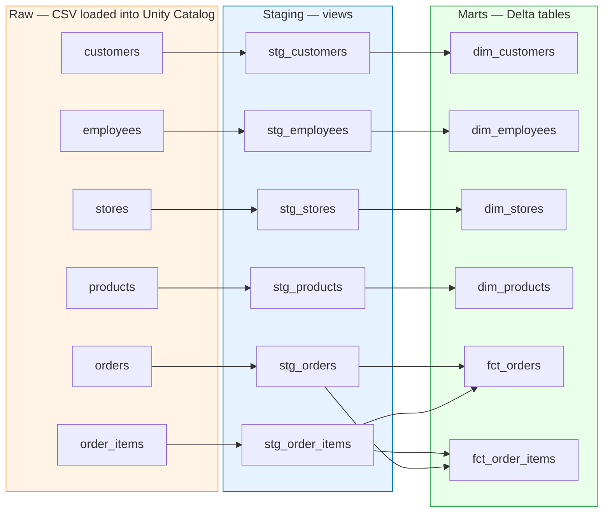
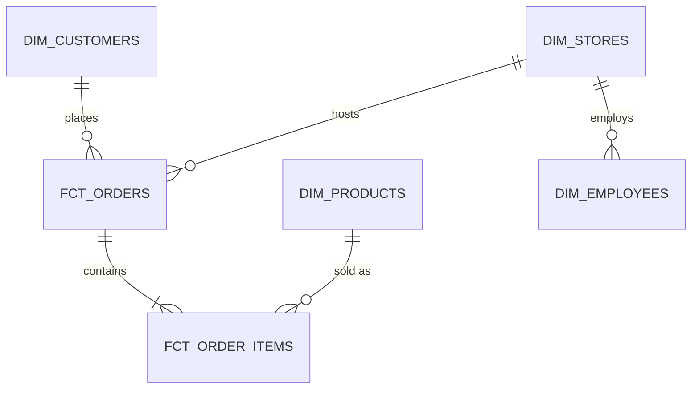

<div align="center">

# 🧙 dbt Wizard

**A dimensional analytics layer built with dbt on Databricks Unity Catalog.**

Six raw CSVs land in a Unity Catalog schema. dbt turns them into a tested,
documented star schema you can actually query.


</div>

---

## What this is

A complete analytics engineering pipeline, end to end:

> **CSV files on a laptop** → **Unity Catalog tables** → **typed staging views** → **dimensional marts** → **tested, queryable star schema**

Nothing is hand-maintained. Change a model, run `dbt build`, and the whole
graph rebuilds with its tests.

---

## Architecture



### The star schema



---

## The data

Retail transactions across a chain of stores.

| Table | Grain | Rows |
|---|---|---:|
| `customers` | one per customer | 2,000 |
| `employees` | one per employee | 250 |
| `stores` | one per store | 25 |
| `products` | one per product | 500 |
| `orders` | one per order | 10,000 |
| `order_items` | one per order line | 30,021 |

---

## Layers

### 🔹 Staging — `models/staging/`

Thin views over the raw tables. One per source, no joins, no business logic.
This is where the data gets *honest*:

- **`is_active`** arrives as a `STRING` holding `'Y'`/`'N'` → cast to a real **boolean**
- **Money columns** arrive as `DOUBLE` → cast to **`decimal(18,2)`**, because floating-point currency is a bug waiting to happen
- **Emails** lowercased, text fields trimmed

### 🔸 Marts — `models/marts/`

Materialized as Delta tables.

| Model | What it gives you |
|---|---|
| `dim_customers` | Customer attributes + derived `full_name` |
| `dim_employees` | Staff, with their store FK |
| `dim_stores` | Store locations |
| `dim_products` | Catalogue with category and brand |
| `fct_orders` | **One row per order**, with line-item totals rolled up |
| `fct_order_items` | **One row per line**, with order context denormalized on |

`fct_orders` carries two columns worth calling out:

- **`header_vs_lines_diff`** — the order's stated `total_amount` minus the sum of its line amounts. A built-in reconciliation check. *Currently zero across all 10,000 orders.*
- **`is_revenue_order`** — flags the 2,447 `Completed` orders. Cancelled, Pending and Returned rows are **kept**, not silently dropped, so you choose your own denominator.

---

## Data quality

46 tests, running on every `dbt build`:

| Test type | Covers |
|---|---|
| `unique` + `not_null` | Every primary key, all 12 models |
| `relationships` | Every FK — orders→customers, orders→stores, items→orders, items→products, employees→stores |
| `accepted_values` | `order_status`, `payment_method` |

```
Done. PASS=58 WARN=0 ERROR=0 SKIP=0 TOTAL=58
```

Referential integrity holds across the whole graph — no orphan line items, no orders without a customer.

---

## Running it

```bash
# from the dbt project directory
dbt build          # staging + marts + all tests
dbt run            # models only
dbt test           # tests only
dbt docs generate && dbt docs serve   # browse the lineage graph
```

Target: **Databricks SQL warehouse** (serverless), catalog `my_wizard`, schema `wizard_schema`.

---

## Notes for anyone forking this

**The `use catalog` pre-hook isn't optional.** `dbt_project.yml` sets:

```yaml
+pre-hook: "use catalog my_wizard"
```

Without it, `CREATE TABLE` fails with `UC_HIVE_METASTORE_DISABLED_EXCEPTION`.
The connection has no default catalog, so the session falls back to
`hive_metastore` — which is disabled on modern workspaces. Views are unaffected
(they allocate no storage), which makes this fail *only* on the marts layer and
look far more mysterious than it is. Setting a default catalog on the
connection is the cleaner fix.

**`generate_schema_name.sql`** overrides dbt's default behaviour of prefixing
custom schemas with the target schema, so `+schema: wizard_schema` means
exactly that rather than `<target>_wizard_schema`.

---

## Layout

```
.
├── models/
│   ├── staging/        # 6 views + sources.yml + tests
│   └── marts/          # 4 dimensions, 2 facts + tests
├── macros/
│   └── generate_schema_name.sql
└── dbt_project.yml     # catalog/schema pinning, materializations, pre-hook
```

<div align="center">
<sub>Built with dbt Core on Databricks Free Edition.</sub>
</div>
